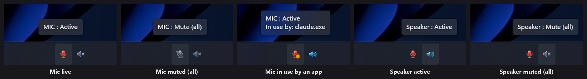
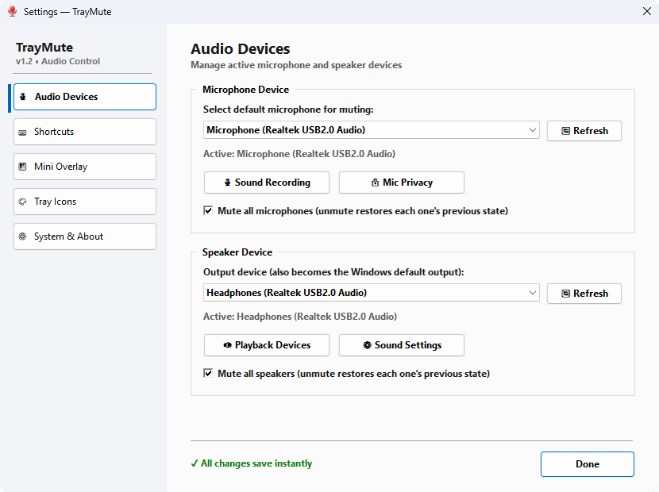
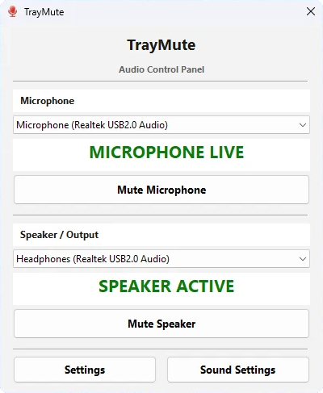
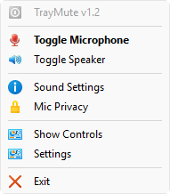

# HushDot — Privacy Signals

**See which app is using your microphone or camera, and mute them all with one click.**
*(Formerly TrayMute. See [Upgrading from TrayMute](#upgrading-from-traymute).)*

Windows 11 shows a microphone or camera indicator only while something uses it, and it rarely
tells you who. HushDot keeps permanent microphone, speaker and camera icons in the system tray:
an **orange dot** when any app is using a microphone and a **green dot** when any app is using
a camera, even while muted, with the app's name when you hover. One click mutes every
microphone (or speaker) and the next click restores them.




## Features

- **Permanent tray icons** for the microphone, the speaker and the camera, showing their status.
  Choose which ones to show in **Settings → Tray Icons** (at least one stays visible).
- **Camera icon**: click it to open the Windows Camera app. A green dot appears whenever any
  app is using a camera; hover to see which. The camera is detected through the official
  Windows sensor activity API, by a small companion program (`HushDot.Sensors.exe`).

  | Icon | Meaning |
  |---|---|
  | Grey camera | No app is using a camera |
  | Violet camera + green dot | The Windows Camera app is open (its preview already uses the camera) |
  | **Grey camera + green dot** | **Another app is using a camera**: a call, or something you did not expect |
- **One-click mute**: left-click the tray icon to toggle the mic (or the speaker)
- **Mute every microphone at once** (on by default): one click silences all audio inputs,
  including virtual ones such as NVIDIA RTX Voice and microphones plugged in while muted.
  Unmuting restores each microphone to the state it was in before, and a microphone unplugged
  while muted is restored when you plug it back in. Can be turned off in Settings.
- **Mute every speaker at once** (on by default): the same for audio outputs (headphones,
  Bluetooth earbuds, monitor speakers), so audio stops wherever Windows or an app is playing
  it. Outputs connected while muted start muted. Has its own switch in Settings.
- **Microphone in-use indicator**: an orange dot on the mic icon whenever any app is using a
  microphone, even while muted. Hover over the icon to see which app it is.
- **Global hotkeys** that also work in full-screen apps and games
  (defaults: `Win+Alt+M` for the mic, `Win+Alt+S` for the speaker; configurable)
- **Floating mini window** with mic/speaker buttons that you can drag anywhere
- **Switch the Windows output**: picking a speaker in Settings or Show Controls also makes it
  the Windows default output, so the browser or player moves to it. The device Windows uses
  for calls is left as it is.
- **Device selection** with automatic detection when devices are plugged in or removed.
  Inputs and outputs are told apart by what Windows reports, so device names in any
  language are listed correctly.
- **Custom tray icons** picked from any `.ico`, `.exe` or `.dll`
- **Optional start with Windows**, off by default

## Screenshots

<p align="center">
  
  &nbsp;
  
</p>
<p align="center">
  
</p>

## Upgrading from TrayMute

HushDot is the new name of TrayMute from version 2.0 on. To upgrade, close TrayMute
(right-click its icon → Exit), extract HushDot into the same folder and start `HushDot.exe`
(or `HushDot.ahk`). On first start HushDot:

- copies your settings (`TrayMute.ini`, also from `%APPDATA%\TrayMute`) to `HushDot.ini`,
  including your devices, hotkeys and mute state;
- replaces TrayMute's "start with Windows" shortcut with its own;
- closes TrayMute if it is still running.

The old `TrayMute.ini` is left untouched, so you can go back to TrayMute if you want. Once
HushDot is running you can delete `TrayMute.exe`, `TrayMute.Sensors.exe` (or `TrayMute.ahk`)
and `TrayMute.ini`.

## Getting started

Requirements: Windows 11. Choose one of the two options below.

### Option A: ready-to-run executable (no AutoHotkey needed)

1. **Download** the `HushDot-v*.zip` file from the [latest release](https://github.com/Niptrion/HushDot/releases/latest)
   and extract it to a folder you own (for example `Documents\HushDot`). Keep `HushDot.exe`,
   `HushDot.Sensors.exe` and the `icons` folder together.
2. **Run** `HushDot.exe`. The executable is not code-signed, so Windows SmartScreen may show
   "Windows protected your PC". Choose **More info → Run anyway**.
3. **Optional: verify the download.** Compare its SHA256 with the one in the release notes:
   ```powershell
   Get-FileHash .\HushDot-v2.0.zip -Algorithm SHA256
   ```

`HushDot.exe` is this repository's `HushDot.ahk` compiled with Ahk2Exe. It contains the
AutoHotkey v2 interpreter, which is licensed under the GPL v2; see `THIRD-PARTY-NOTICES.md`
in the zip. `HushDot.Sensors.exe` is the camera helper built from [`helper/`](helper)
(MIT License).

### Option B: run the script with AutoHotkey v2

1. **Install [AutoHotkey v2](https://www.autohotkey.com/)**, either from the website or with winget:
   ```powershell
   winget install --id AutoHotkey.AutoHotkey --exact --source winget
   ```
2. **Download HushDot**: clone this repository, or use *Code → Download ZIP* and extract it
   to a folder you own (for example `Documents\HushDot`).
3. **Run it**: double-click `HushDot.ahk`. The microphone and speaker icons appear in the
   system tray. If they are hidden, drag them from the `^` overflow area onto the taskbar.
   If double-clicking does nothing (some per-user AutoHotkey installs don't associate `.ahk`
   files), create a shortcut whose target is the interpreter followed by the script, e.g.
   `"%LOCALAPPDATA%\Programs\AutoHotkey\v2\AutoHotkey64.exe" "C:\path\to\HushDot.ahk"`.

### Using it

HushDot has no main window. When you start it, a small box above the clock says it is running
(you can turn it off with *Don't show this again*, and back on in **Settings → System &
About**). Windows 11
puts new tray icons behind the **^** arrow next to the clock, so drag them from there onto the
taskbar. To hide one again, drag it back onto the **^** arrow, or turn it off in Windows
**Settings → Personalization → Taskbar → Other system tray icons**.

Left-click the microphone or speaker icon to mute or unmute it, and the camera icon to open
the Camera app. Right-click any of them for the menu (Settings, Show Controls, Exit).

To start HushDot with Windows, open **Settings → System & About** and tick
*Run HushDot on Windows Startup*. This creates a shortcut in your Startup folder (for the
script version it launches the script through AutoHotkey, so it works even without a `.ahk`
file association), and unticking the box removes it.

Settings are saved to `HushDot.ini` next to the program. If that folder is not writable,
for example inside `Program Files`, they go to `%APPDATA%\HushDot\` instead.

### Choosing the right microphone

On first run HushDot selects the first microphone it finds (in alphabetical order),
not necessarily your Windows default. Open **Settings** and pick the microphone you
actually use.

With **Mute all microphones** turned on (the default), every input is muted together, so
the choice below only matters if you turn that option off.

If you use a virtual microphone such as NVIDIA RTX Voice or NVIDIA Broadcast, select
the **physical** microphone that the virtual one uses as its input. Some virtual audio
drivers ignore the Windows mute: the tray icon changes, but the audio keeps flowing.
Muting the physical microphone silences every app.

The virtual microphone only works while its app is running. If you close RTX Voice or
Broadcast, apps set to its microphone get no audio, and the physical microphone on its own
may sound much quieter, because the noise removal and level boost are gone.

Tip: the level meter in Windows Sound settings may keep moving even when the mic is
muted. To check, record a few seconds (for example with the Voice Recorder app) and
play it back.

## What "Mute all" can and cannot do

HushDot mutes microphones the same way Windows Sound settings do: it turns on the Windows
mute of every microphone. That silences the microphone for practically every app, but it is
not an absolute guarantee. Audio can still get through in these cases:

- **Exclusive mode.** An app can open a microphone in exclusive mode and talk to the driver
  directly, bypassing the Windows audio mixer. Most USB and Bluetooth microphones and webcams
  have no hardware mute, so Windows applies the mute in that mixer, and an exclusive-mode app
  may still receive sound.
- **Apps that unmute.** Any app can turn a microphone's mute off again. HushDot notices
  within a second and the icon turns red again, but it does not fight the app by re-muting.
- **Virtual microphones.** Some virtual audio drivers, such as noise-removal apps, ignore the
  Windows mute on their own virtual microphone. Muting the physical microphone they use
  silences them too, and "Mute all" does that.
- **Software below the Windows audio system.** Malware with administrator rights or its own
  driver can read the hardware directly, and could also close HushDot. Only a physical
  switch, or disabling the device (which needs administrator rights), is absolute.

**What HushDot does about it: the orange dot.** Whenever any app is using a microphone,
muted or not, the mic icon shows an orange dot in its lower-right corner, like the
camera and microphone indicator on a phone. Hover over the icon to see which app or program
it is (for example `In use by: Zoom.exe`). If everything is muted and something still opens a
microphone, you see it and you know who it is.

The information comes from the records Windows keeps for its own microphone privacy
indicator, plus the live audio sessions. HushDot only reads them. Software that bypasses the
Windows audio system entirely (the last case above) is not visible this way either.

## Known issues

- **Some USB webcam microphones stop capturing after being muted and unmuted.** Windows
  reports them as active and unmuted, but no sound comes through. This was seen with a
  Logitech C922. Unplugging and replugging the webcam (or restarting the PC) brings it back.
  If it happens often, turn off *Mute all microphones* so only your selected microphone is
  toggled.
- **The camera's green dot needs `HushDot.Sensors.exe`.** AutoHotkey cannot receive the
  Windows sensor activity reports itself, so a small helper listens to them and passes them
  on. It never opens a camera, has no network access and closes when HushDot closes. Without
  it (file missing, blocked by antivirus, or Windows "N" editions without the Media Feature
  Pack), HushDot falls back to the per-app records Windows keeps for its privacy indicator,
  which recent Windows 11 versions no longer update, so the dot may not appear there. The
  script version (Option B) builds the helper with `helper\build-helper.cmd`, which uses the
  C# compiler included with Windows.
- **"Mute all speakers" also mutes virtual outputs** such as VB-Cable or Voicemeeter, which
  silences anything you stream or record through them. If you use those, turn the option off.

## Privacy and safety

- **No telemetry and no network access.** HushDot never connects to the internet. The only
  links (Credits and Sponsor) open in your browser when you click them.
- **No registry changes, services or background installers.** It writes only its own
  `HushDot.ini` and, if you enable it, the startup shortcut.
- **Muted stays muted.** If you exit HushDot while all microphones are muted, they stay
  muted. Start HushDot again and click the icon to restore them.
- **Readable source.** HushDot is a plain-text AutoHotkey script plus a small C# camera
  helper ([`helper/HushDot.Sensors.cs`](helper/HushDot.Sensors.cs)). The original script was
  reviewed line by line before this fork was published; see [`NOTICE.md`](NOTICE.md) for the
  details and file hashes.

## Credits and license

HushDot (formerly TrayMute) is an unofficial fork of [**MuteGuard**](https://github.com/xionraj/MuteGuard) by
xionraj (Raja Mukherjee). All the core functionality is their work. HushDot is not affiliated
with or endorsed by the original author.

Released under the [MIT License](LICENSE), Copyright (c) 2026 Raja Mukherjee.
See [`NOTICE.md`](NOTICE.md) for where the source came from and what changed.

---

💖 Like HushDot? [Sponsor this fork on GitHub](https://github.com/sponsors/Niptrion).
